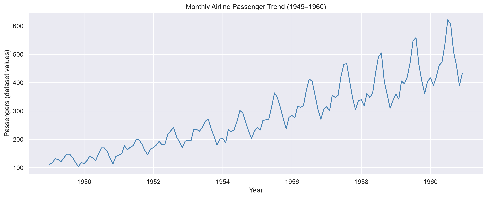

# Data Science Portfolio

**Name:** PEI JIAYI

## About Me

I am a student studying data science through coursework and practical projects. I am developing my ability to prepare data, explore patterns, create visualizations, and communicate findings clearly.

This portfolio presents my analysis projects and documents my progress in reproducible data analysis.

## Technical Skills

- **Python:** writing and running data analysis code
- **Pandas and NumPy:** data inspection, transformation, and aggregation
- **Matplotlib and Seaborn:** creating charts and exploring visual patterns
- **Jupyter Notebook:** combining code, outputs, and explanations
- **GitHub:** organizing project code and documentation

## Project Showcase

### Airline Passenger Trends and Seasonality (1949–1960)

**Research question:** How did monthly airline passenger numbers change between 1949 and 1960, and what seasonal patterns can be observed?

**Status:** Completed exploratory analysis.

#### Visualization

**At a glance:** Passenger numbers increased over the period, with recurring summer peaks. These historical patterns do not explain their causes or represent present-day airline demand.

The line chart shows a long-term increase in passenger numbers alongside recurring seasonal fluctuations. The heatmap in the project repository provides a complementary comparison across months and years.

Annual passenger totals increased approximately 3.76-fold between 1949 and 1960. July and August had the highest average monthly values across the period.

#### Methods

The analysis uses Pandas to reshape and sort 144 monthly observations, Seaborn to create a heatmap, and Matplotlib to create a chronological line chart.

#### Limitation

The dataset contains historical aggregate observations. It cannot establish the causes of the patterns or directly represent current airline demand.

#### Project Materials

[View project code, visualizations, and reproduction instructions](https://github.com/mc63269/data-science-project.git)

The project builds on CISC7204 Activity 7.01 and extends the original heatmap exercise with a chronological line chart and project documentation.

## Next Steps

I plan to strengthen my statistical analysis skills, add further projects, and improve the clarity and reproducibility of my documentation.
